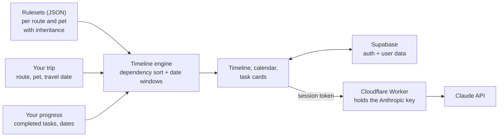

# Mypetravel

An assistant for moving abroad with a pet. Tell it where you're going, when, and with which animal, and it builds the whole plan: every vet visit, test, permit, airline booking and document, in the right order, with a date on each one.

Built after relocating internationally with my dog, Jax. The rules are real: the first route covered is South Africa to the EU, one of the strictest, with a mandatory rabies titer test and a 3 month waiting period that catches people out every year.

**Try it:** [mypetravel.com](https://mypetravel.com)

## What it does

* **A dated plan, not a checklist.** Each task has a timing rule ("10 to 1 days before travel", "30 days after the rabies vaccine", "before the titer test"). The app turns those rules into real dates from your travel date and shows what's due now, what's coming, what's blocked and what's overdue.
* **Explains why.** Every task says why it exists and which documents prove it, with the official regulation behind the ruleset.
* **Documents, todos and calendar** in one place, synced to your account.
* **Ask Claude:** an assistant that already knows your pet, route and travel date.

## How it works



### The rules engine

Requirements live in versioned JSON rulesets (`config/rules/`), not in code. Each task declares its dependencies and a timing constraint:

| Timing | Meaning |
|---|---|
| `before_travel` | A window before departure, e.g. health certificate 10 to 1 days before |
| `after_task` | N days after another task is done, e.g. titer test 30 days after the rabies vaccine |
| `before_task` | Must be done N days before another task |
| `anytime` | No date constraint |

`buildTimeline()` sorts the tasks by dependency (topological sort), resolves each window into dates using your travel date and the dates you completed earlier tasks, and gives every task a status: completed, in progress, due soon, in window, upcoming, blocked, overdue, or for waiting periods, milestone reached or pending.

Country specific rules extend a base ruleset instead of copying it. Finland and Malta inherit the EU rules for dogs from South Africa and add their own tapeworm treatment. Updated rulesets can be fetched from a manifest at runtime, falling back to the bundled version if the network is slow.

### Ask Claude

The app never holds an AI key. Requests go to a small Cloudflare Worker (`worker/`) that checks the user's Supabase session, only accepts calls from the app's own domains, builds the system prompt from the trip details and caps model, token budget and message sizes. The same Worker pings Supabase daily so the free project never pauses. Details in [`worker/README.md`](worker/README.md).

## Stack

React Native and Expo (iOS, Android and web from one codebase), TypeScript, Zustand, Supabase (Postgres, Auth with Google OAuth, row level security), Cloudflare Workers, Claude API, Netlify.

## Run locally

```bash
npm install
cp .env.example .env.local   # fill in the values
npm run web                  # or npm run ios / npm run android
```

Ask Claude needs the Worker running: see [`worker/README.md`](worker/README.md).

## Code map

| Path | What it does |
|---|---|
| `src/engine/timeline.ts` | Dependency sort, date windows and task statuses |
| `src/engine/configLoader.ts` | Loads rulesets, inheritance, remote updates with fallback |
| `config/rules/` | Route rulesets and manifest |
| `src/store/useAppStore.ts` | App state, synced to Supabase |
| `src/lib/askClaude.ts` | Ask Claude client |
| `worker/` | Cloudflare Worker: Ask Claude backend and Supabase keep alive |
